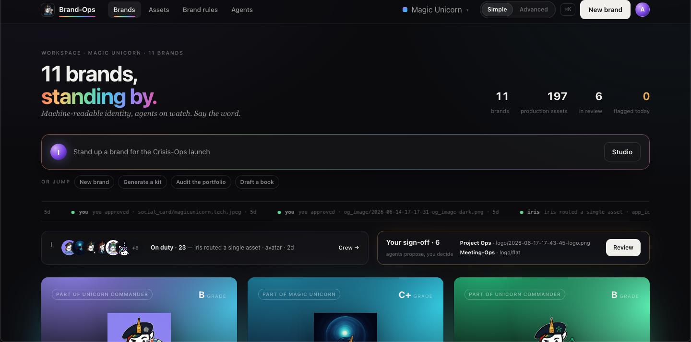
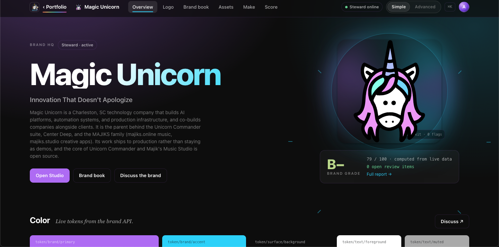
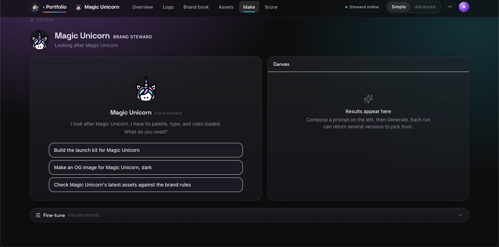
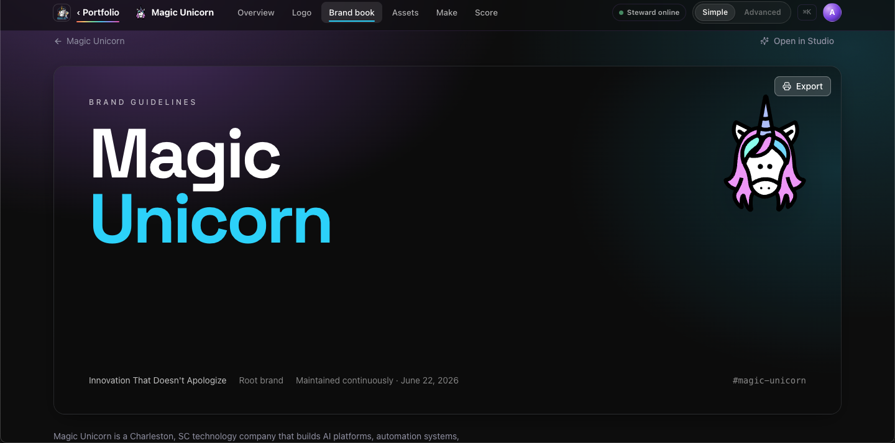
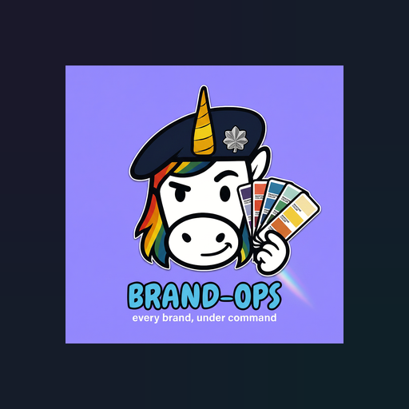
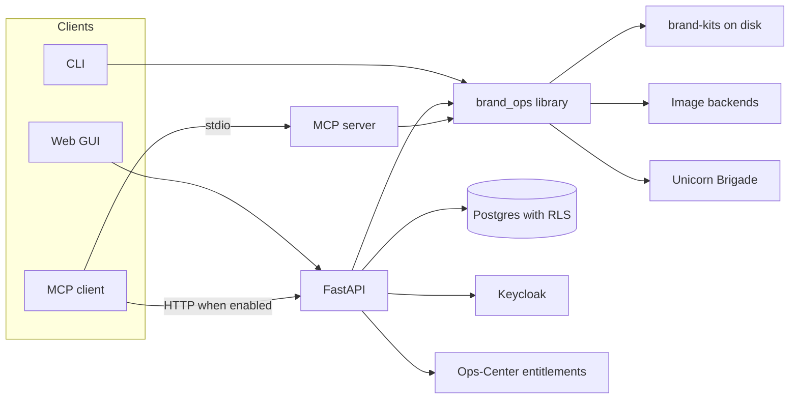

<p align="center">
  
</p>

<h1 align="center">Brand-Ops</h1>

<p align="center">
  Machine-readable brand kits, and the studio that generates and checks on-brand assets.
</p>

<p align="center">
  <a href="LICENSE"></a>
  
  
  
  
  
</p>

<p align="center">
  <a href="#quick-start">Quick start</a> ·
  <a href="#feature-tour">Features</a> ·
  <a href="#built-for-agents">Agents</a> ·
  <a href="#architecture">Architecture</a> ·
  <a href="#part-of-unicorn-commander">Suite</a>
</p>

<p align="center">
  Public origin used by the web build:
  <a href="https://brand-ops.unicorncommander.ai">brand-ops.unicorncommander.ai</a>
</p>

<p align="center">
  
</p>

## What is Brand-Ops?

Brand-Ops is the system of record for a brand and the studio that produces its assets. It stores each brand's palette, type, voice, and rules as data, then lets a person or an agent generate assets against that record and check an image or a piece of copy for compliance. One engine sits behind a command line, a REST API, an MCP server, and a web app. It is self-hosted and multi-tenant, and it is part of [Unicorn Commander](https://unicorncommander.ai), which shares sign-in and can share inference and entitlements across the suite. Agents draft, route, and critique. An asset marked `needs_review` does not count toward asset coverage. A generation that calls a model does not run until something asks for it.

## Highlights

- **The brand is data, not a slide deck.** `brand.yaml` holds colors, fonts, voice, forbidden phrases, and the mark. The CLI, API, and MCP tools load that file; the GUI reads the API's projection of it.
- **Look before you spend.** `build_prompt` returns the composed prompt; `brand-ops generate --dry-run` prints it. No image backend is called.
- **Text cards are drawn, not guessed.** Share images and social cards draw the supplied text with bundled fonts and the brand's colors; the launcher tile has no text. A decodable raster mark is composited when available, and the same inputs produce the same pixels.
- **Compliance records a verdict and a review state.** Copy is failed for a brand's forbidden phrases or an em-dash. Colors are compared with the palette. Failures are stamped `needs_review`; owners can change that state through the API or MCP.
- **Agents do the drafting.** Iris (the `director`) talks in the Studio and routes the ask. Specialists research, take a brand in, pack assets, draw avatars, critique, tag, and refine. Every brand has a steward in the team view. The default steward uses the brand mark as its avatar; created agents can have generated avatars and a bound voice.
- **Tenants are isolated twice.** Postgres row level security is forced on the tenancy tables, and brand files live under `brand-kits/<workspace_id>/<slug>/` when a workspace is in scope.
- **Several ways to make a picture.** Image calls can go to Gemini, OpenAI, Recraft, a local FLUX/ComfyUI server, OpenRouter, or a LiteLLM gateway. Five locked template definitions are exposed by REST and MCP without calling a model; the HTML canvas renderer is in `web/src/pages/templates/render.ts`.
- **A link can unfurl on brand.** `share-meta` prints the Open Graph and Twitter tags for a brand's own site, and the same kit is on `GET /api/brands/{slug}/share-preview`.

## Feature tour

### Portfolio

The front door lists every brand you can see, with coverage of the asset types and the agents on watch. Opening a brand themes the workspace to that brand's palette and sets its display and body font stacks. Inter and Space Grotesk are bundled; other families use locally available fonts or fallbacks.

<p align="center">
  
</p>

### Brand HQ

A brand's home screen is its mark, its grade, and its color tokens, drawn from the brand record rather than a separate theme file.

<p align="center">
  
</p>

### Studio

The Studio is where a steward or Iris takes a plain-language ask: build a kit, make an OG image, or check assets against the rules. A pack request runs the `asset_pack` agent. A single asset can be previewed as a prompt before anything is generated.

<p align="center">
  
</p>

### Brand book

Guidelines are rendered from the brand record: identity, color tokens, typography, voice, asset coverage, and a link-preview kit you can copy.

<p align="center">
  
</p>

### Launcher tile

The `launcher_tile` asset type (512×512) is intended for an Ops-Center launcher icon. Use `brand-ops card --asset launcher_tile --brand <slug>` to compose it from the palette and an available raster mark without a model. Registration notes are in docs/ops-center-registration.md; its SQL examples require verification against the target Ops-Center schema.

<p align="center">
  
</p>

The same GUI also has a library (`/library` and `/b/:slug/assets`), a mark page (`/b/:slug/mark`), a grade page (`/standards` and `/b/:slug/grade`), a crew page for the per-brand cast (`/crew`), new-brand intake (`/brands/new`), and settings. `/workflows` and `/templates` redirect into the Studio.

## Built for agents

Brand-Ops exposes brand and asset workflows as MCP tools, so an agent can list brands, compose a prompt, generate or draw an asset, check compliance, and stand up a steward without clicking through the app.

**Transports.** Stdio is `python -m brand_ops.mcp_server`. It refuses to start unless `BRAND_OPS_MCP_TOKEN` is set. Calls enforce the resolved workspace and role; stdio authentication is cached for up to 60 seconds before revalidation. Streamable HTTP is mounted at `/mcp` only when `MCP_HTTP_ENABLED` is true. HTTP MCP always requires a bearer. Turning `AUTH_REQUIRED` off for local GUI work does not open `/mcp`. Discovery, when HTTP is on, is `GET /.well-known/mcps.json`.

**Auth.** A bearer is either a suite JWT (the configured Keycloak realm, default `uchub`, or a configured trusted Brigade issuer) or a Brand-Ops personal access token. Tokens use the prefix `brand_pat_` and are minted at `POST /api/tokens` by a member, admin, or owner using a non-delegated suite JWT. PATs and delegated agent credentials cannot mint PATs. The anonymous local principal cannot mint one. Tools are allowed or refused with the same roles as the REST API: viewer, member, admin, owner.

**Surface.** 36 tools, 3 resources, 4 resource templates, and 3 prompts. The resources are `brand-ops://brands`, `brand-ops://asset-types`, and `brand-ops://templates`; resource templates expose per-brand guidelines, assets, tokens, and agents. The prompts are `launch_full_brand_kit`, `audit_brand_compliance`, and `stand_up_steward_agent`.

Tools you will actually call:

| Tool | What it does |
|---|---|
| `list_brands`, `get_brand` | Read the brands this credential can see, and one brand's identity |
| `build_prompt` | Compose an image prompt and return it. No backend call |
| `generate_asset` | Generate one asset with the selected backend; hosted providers may charge |
| `generate_card` | Draw an OG image, social card, or launcher tile. No model |
| `generate_brand_kit` | Fill the asset types a brand is still missing |
| `check_compliance`, `get_brand_compliance` | Check copy or a file, or roll up a brand |
| `director_chat` | Talk to Iris and get a routed intent |
| `get_share_preview` | The Open Graph and Twitter tags for a brand's site |
| `intake_brand`, `new_brand`, `clone_brand` | Draft a brand, create one, or copy one |
| `approve_asset`, `transition_asset` | Move an asset through review; requires the workspace owner role |

Eight agent implementations are listed in the Brigade-format registry: `director` (Iris), `brand_research`, `brand_intake`, `asset_pack`, `avatar`, `brand_critic`, `tagger`, and `refine`. A ninth agent class, exposed as `generation_planner`, turns free text into a generation request and is not in that registry. There is no separate A2A endpoint. The registry can build a Brigade-format manifest, and `brand_research` can call Brigade's research API. Research requires `BRIGADE_API_KEY`; `BRIGADE_BASE_URL` defaults to `https://brigade.unicorncommander.ai` and can be overridden. Agent chat falls back in persona when the LLM gateway has no key.

Stdio client, launched from the repo root after the source install below (credential and workspace resolution need Postgres):

```json
{
  "mcpServers": {
    "brand-ops": {
      "command": "uv",
      "args": ["run", "python", "-m", "brand_ops.mcp_server"],
      "env": {
        "BRAND_OPS_MCP_TOKEN": "<token>",
        "DATABASE_URL": "postgresql+asyncpg://<user>:<password>@localhost:5432/brand_ops",
        "BRAND_OPS_MCP_WORKSPACE_ID": "<workspace-uuid>"
      }
    }
  }
}
```

HTTP client, after the API is up with `MCP_HTTP_ENABLED=true`:

```json
{
  "mcpServers": {
    "brand-ops": {
      "url": "http://127.0.0.1:8000/mcp",
      "headers": {
        "Authorization": "Bearer <token>"
      }
    }
  }
}
```

`BRAND_OPS_MCP_WORKSPACE_ID` only selects a workspace the token's owner already belongs to.

## Quick start

You can list brands, dry-run a prompt, draw a card, and open the GUI with no provider key and no suite login. Model-backed image generation needs a configured cloud backend or a reachable FLUX/ComfyUI server. With no usable backend, `POST /api/generate` returns HTTP 422. Agent chat answers 200 with an in-persona fallback when no LLM key is configured. `/health` is the liveness probe. `/readyz` stays not-ready until Postgres answers and a backend in `FALLBACK_IMAGE_BACKENDS` passes its health check; the default list is `litellm,openrouter`, and this path configures neither.

The CLI imports Pillow. Pillow is the `backends` extra, so install that or `brand-ops` will not start.

### Docker

The API image serves the REST API on port 8000. It does not include the web GUI. `AUTH_REQUIRED` defaults to true, and a container that leaves it unset will refuse to boot unless `DATABASE_URL` and `BRAND_OPS_BOOTSTRAP_WORKSPACE_ID` are set. For a local look, turn that check off explicitly and bind the port to loopback. Refresh the lockfile with uv before building: its package metadata trails `pyproject.toml` at this revision.

```bash
uv lock
docker build -t brand-ops .
docker run --rm -p 127.0.0.1:8000:8000 -e AUTH_REQUIRED=false brand-ops
```

Then open `http://localhost:8000/docs` and `http://localhost:8000/api/brands`. The image copies the curated kits in and seeds them on boot, copy-if-missing, into `/app/brand-kits` for this local run. Mount a volume there to keep generated assets across container removal.

The GUI image is `web/Dockerfile.prod`. The suite stack connects the GUI, API, Postgres, and an oauth2-proxy to an existing Keycloak realm:

```bash
docker compose --env-file deploy/.env -f deploy/docker-compose.unicorncommander.yml up -d --build
```

Run that from the repo root. It expects the suite's external Docker networks, Traefik, a root `.env`, `deploy/.env` (database passwords), and `deploy/.env.oauth2` (the oauth2-proxy). Those env files are not in git. The public host in that compose file is `brand-ops.unicorncommander.ai`, and sign-in is the shared Keycloak realm. `deploy/docker-compose.prod.yml` is an alternative suite profile with different proxy and external-service settings. `deploy/docker-compose.yml` is the API alone and also expects those external networks. None of the compose files is a single-machine `docker compose up` with no surrounding suite.

With auth left on, the process also requires `DATABASE_URL` and `BRAND_OPS_BOOTSTRAP_WORKSPACE_ID`. Migrations run as the database owner (`alembic upgrade head`). The runtime role is not allowed to bypass row level security. See docs/deploy.md and docs/DEPLOY-TENANCY.md.

### Run from source

Requires Python 3.12 or newer, [uv](https://docs.astral.sh/uv/), and Node for the GUI. The production web image builds on Node 20.18.0.

```bash
uv sync --extra backends --extra dev
export AUTH_REQUIRED=false

uv run brand-ops list-brands

uv run brand-ops generate --brand magic-unicorn --asset og_image \
  --topic "investor update" --dry-run

uv run uvicorn brand_ops.api.app:app --reload --host 127.0.0.1 --port 8000
```

In a second terminal:

```bash
npm --prefix web install
npm --prefix web run dev
```

The GUI is at `http://localhost:5173`. It calls relative `/api` paths, and the Vite dev server proxies those to `http://localhost:8000` ([web/vite.config.ts](web/vite.config.ts)).

Draw a card without a model. The compositor uses a decodable raster mark when available; SVG-only or missing marks fall back to another raster logo or a card without a mark:

```bash
uv run brand-ops card --brand brand-ops --asset og_image \
  --message "Every brand, under command." --out /tmp/og.png

uv run brand-ops card --brand magic-unicorn --asset social_card \
  --message "Hello from the studio."
```

`og_image` is 1200×630. `social_card` is 1080×1080. Omit `--out` and the social card is saved into that brand's catalog. The web app ships a default card at `web/public/og.png` and the tags in `web/index.html`. The absolute origin in those tags is `BRAND_OPS_SITE_URL` at build time, otherwise `https://brand-ops.unicorncommander.ai`.

Print the tags for a brand's own site. The canonical URL comes from `--url` or `brand.website`; `--image-url` selects the hosted image, otherwise it defaults to `<site>/og.png`. With no site configured, the tags use a marked example domain:

```bash
uv run brand-ops share-meta --brand magic-unicorn --url https://magicunicorn.tech
```

Host the image at that URL and paste the tags into the brand's own site. The brand book's Link preview section has a site-URL field and a copy button; generating tags does not publish them to that site.

Bring a brand's known on-disk files into the managed catalog. Source locations come from `src/brand_ops/ingest.py:IMPORT_SOURCES`; missing paths are skipped, so external source trees may need to be supplied first. This writes under `brand-kits/` and is safe to repeat:

```bash
uv run brand-ops ingest --brand majiks
uv run brand-ops ingest
```

`ingest` copies into `brand-kits/<slug>/imported/<asset_type>/` and writes a catalog sidecar next to each file. Generated and imported bytes are gitignored. The Library and API serve cataloged assets; use Library upload for files outside the ingest mappings.

Other CLI commands: `backfill-compliance` stamps each catalog sidecar with the checker's lifecycle status.

### Configuration

Copy [.env.example](.env.example) to `.env`. Never commit `.env`. For source runs, export the configured values into the process environment; the Python settings loader does not load `.env` itself.

| Variable | Meaning |
|---|---|
| `GEMINI_API_KEY` | Key for the Gemini image backend |
| `OPENAI_API_KEY` | Key for the OpenAI image backend |
| `RECRAFT_API_KEY` | Key for the Recraft backend, used when you want a native SVG path |
| `COMFYUI_URL` | Base URL of a ComfyUI server for the local FLUX backend |
| `BRIGADE_BASE_URL` | Unicorn Brigade base URL |
| `BRIGADE_API_KEY` | Key sent to Brigade |
| `GARAGE_S3_ENDPOINT` | Reserved S3 endpoint setting; no asset mirror is implemented |
| `GARAGE_S3_ACCESS_KEY` | Reserved S3 access-key setting; currently unused |
| `GARAGE_S3_SECRET_KEY` | Reserved S3 secret-key setting; currently unused |
| `GARAGE_S3_REGION` | Reserved S3 region setting; currently unused |
| `GARAGE_S3_BUCKET` | Reserved S3 bucket setting; currently unused |
| `KEYCLOAK_REALM_URL` | Realm URL used to verify suite SSO tokens |
| `KEYCLOAK_CLIENT_ID` | OAuth client id for this app |
| `KEYCLOAK_CLIENT_SECRET` | Client-secret setting read into configuration; no runtime consumer in this package |
| `DATABASE_URL` | SQLAlchemy URL for the tenancy database (`postgresql+asyncpg://…`) |

Additional settings are read directly from the environment:

| Variable | Meaning |
|---|---|
| `AUTH_REQUIRED` | Defaults to true. Every `/api` route then requires a bearer, and boot requires `DATABASE_URL` and `BRAND_OPS_BOOTSTRAP_WORKSPACE_ID`. Set `AUTH_REQUIRED=false` only for a local CLI, API, and GUI |
| `BRAND_OPS_BOOTSTRAP_WORKSPACE_ID` | Workspace id the seeded kits are bound to when auth is on |
| `MCP_HTTP_ENABLED` | Mount `/mcp` and `/.well-known/mcps.json`. Off unless set |
| `BRAND_OPS_MCP_TOKEN` | Bearer the stdio MCP server requires before it will start |
| `LLM_BASE_URL` | OpenAI-compatible base URL for agent chat |
| `LLM_API_KEY` | Key for that chat gateway. If empty, `OPENROUTER_API_KEY` is used |
| `LITELLM_BASE_URL` | Gateway root. When set, image calls can go there instead of a provider key in this process |
| `LITELLM_API_KEY` | Virtual key for that gateway |
| `LITELLM_IMAGE_MODEL` | Gateway image model; chat-style image models carry reference images |
| `OPENROUTER_API_KEY` | Direct OpenRouter image key and fallback key for agent chat |
| `OPENROUTER_IMAGE_MODEL` | Image model used by the direct OpenRouter adapter |
| `FALLBACK_IMAGE_BACKENDS` | Comma-separated fallback order and readiness-check list; defaults to `litellm,openrouter` |
| `MCP_PUBLIC_URL` | Advertised HTTP MCP URL; also adds its host to the MCP host allow-list |
| `BRAND_OPS_SELF_SERVE_SIGNUP` | Off unless set. When on, an authenticated user with no workspace may provision one |
| `BRAND_OPS_SITE_URL` | Absolute origin written into Open Graph tags at web build time |
| `BRAND_OPS_IMAGE_CAP_CENTS` | Soft per-workspace check of recorded image spend over the last 30 days, in US cents. Unset or `0` disables it; unscoped calls and database failures skip the check |
| `BRAND_OPS_RATELIMIT` | Spend-route limit. Default `30/minute` |
| `SENTRY_DSN` | Optional error reporting. The SDK is the `sentry` extra and is not imported unless this is set |

Further knobs for entitlements, CORS, the admin allow-list, and Orator TTS are read in [src/brand_ops/config.py](src/brand_ops/config.py) and the API modules; retention is handled by `src/brand_ops/retention_sweep.py`. Entitlement enforcement is off unless `BRAND_OPS_ENTITLEMENT_ENFORCED=true` (or another accepted true value). The feature key it checks defaults to `brand_ops_access`.

**Self-serve signup.** Off by default. An operator otherwise creates a workspace and grants members. With `BRAND_OPS_SELF_SERVE_SIGNUP=true`, an authenticated suite user who has no workspace gets a setup screen, and `POST /api/onboarding/provision` creates an owner and a default workspace. It is idempotent and audited. Brand-Ops does not bill. Hosted-generation access and workspace image budgets use the entitlement check and `BRAND_OPS_IMAGE_CAP_CENTS`; agent governance also supports weekly budgets. Letting a brand-new person register a `uchub` account is a Keycloak realm setting, not a Brand-Ops flag. See docs/DEPLOY-TENANCY.md.

## Architecture



| Piece | Where it lives |
|---|---|
| Web GUI | `web/`. Vite, React 18, React Router, TanStack Query. Routes: portfolio, brand HQ, mark, book, library, studio, grade, crew, new brand, settings |
| REST API | `src/brand_ops/api/`. FastAPI. With auth off and MCP HTTP off, the OpenAPI document lists 55 operations on 51 paths. `/readyz` and `/metrics` are mounted outside that schema |
| CLI | `brand-ops`, six commands: `list-brands`, `generate`, `card`, `share-meta`, `ingest`, `backfill-compliance` |
| MCP | `src/brand_ops/mcp_server.py`, plus the HTTP mount in `src/brand_ops/api/mcp_http.py` |
| Engine | Prompt builder, deterministic cards, compliance, catalog, ingest |
| Brand files | `brand-kits/<slug>/` when unscoped (CLI, tests, auth off). `brand-kits/<workspace_id>/<slug>/` when a workspace is in scope |
| Database | Postgres 16 in the compose files. Eight Alembic revisions under `alembic/versions/`. Row level security is enabled and forced |
| Image backends | `litellm`, `openrouter`, `gemini`, `openai`, `recraft`, `flux` |
| Agents | `src/brand_ops/agents/` and per-brand files under `brand-kits/<slug>/agents/` |
| Optional edges | Orator for voice preview, Redis for the rate limiter, Sentry |

On a fresh checkout the CLI lists 29 brands under `brand-kits/`. `_template/` is the authoring starter and is not one of them. Asset-type target sizes are `logo` (2048²), `app_icon` (1024²), `launcher_tile` (512²), `og_image` (1200×630), `podcast_cover` (3000²), `social_card` (1080²), and `avatar` (1024²). Named generation packs are `core`, `social`, `logo`, `podcast`, and `launch`. Locked templates are `og_hero`, `social_square`, `social_story`, `quote_card`, and `feature_announcement`.

**What the server enforces**

- Auth fails closed. A missing `AUTH_REQUIRED` means on, not off.
- By default, generation, planning, voice-preview, intake, agent-run, and signup REST POSTs are rate limited; `/mcp` is outside this limiter. The default is 30 requests per minute per caller bucket, per process (`BRAND_OPS_RATELIMIT`). `/health`, `/readyz`, `/metrics`, and reads are not limited. The store is in-memory unless `BRAND_OPS_RATELIMIT_REDIS_URL` is set (`ratelimit-redis` extra).
- Activity and admin audit logs are hash-chained. `GET /api/admin/workspaces/{workspace_id}/audit/verify` checks that workspace's activity chain.
- Uploaded rasters are opened and checked against the claimed format. Intake and the LiteLLM/OpenRouter result fetchers validate initial URLs against public HTTP/HTTPS rules. Their redirect checks run after fetching; the Recraft result downloader does not use this guard.
- Admin routes support workspace export (`GET /api/admin/workspaces/{workspace_id}/export`) and deletion, gated by the operator allow-list and admin tier. Deleting a workspace requires a matching confirmation.
- `/readyz` returns 503 when Postgres is unset or down, or when no backend in `FALLBACK_IMAGE_BACKENDS` passes its health check, so a load balancer can stop sending traffic. Shutdown closes the database pool.
- Prometheus metrics are on `/metrics` when `prometheus-fastapi-instrumentator` imports, which it does as a core dependency.

**Layout**

```text
brand-kits/<slug>/brand.yaml          brand definition
brand-kits/<slug>/refs/               reference images
brand-kits/<slug>/imported/           ingested assets, not in git
brand-kits/<slug>/generated/          model output, not in git
brand-kits/<slug>/agents/<agent>/     avatar and persona
src/brand_ops/                        library, CLI, API, MCP, agents, database
web/                                  GUI
deploy/                               compose files and the Postgres init script
```

The single path resolver is `brand_loader.current_kits_dir()`. Set `BRAND_OPS_BOOTSTRAP_WORKSPACE_ID` to the destination workspace UUID before copying an existing flat tree into per-workspace directories. Inspect the copied files before `--cleanup`: that command only checks for a destination `brand.yaml` before deleting a flat brand directory.

```bash
python -m brand_ops.migrate_storage --dry-run
python -m brand_ops.migrate_storage
python -m brand_ops.migrate_storage --cleanup
```

**Conventions.** Use uv, not pip. Brand-facing copy does not use em-dashes or marketing filler. The copy linter reports prompt warnings; it does not block generation. Do not commit generated assets, imported bytes, or secrets.

## Part of Unicorn Commander

| App | Connection in this repository |
|---|---|
| [Ops-Center](https://github.com/Unicorn-Commander/Ops-Center) | Entitlement client and launcher registration notes |
| [Unicorn-Brigade](https://github.com/Unicorn-Commander/Unicorn-Brigade) | Research client and agent manifest definitions |
| [Unicorn-Stable](https://github.com/Unicorn-Commander/Unicorn-Stable) | Brand kit: `brand-kits/stable/` |
| [Accounting-Ops](https://github.com/Unicorn-Commander/Accounting-Ops) | Brand kit: `brand-kits/accounting-ops/` |
| [Contact-Ops](https://github.com/Unicorn-Commander/Contact-Ops) | Brand kit: `brand-kits/contact-ops/` |
| [Customer-Ops](https://github.com/Unicorn-Commander/Customer-Ops) | Brand kit: `brand-kits/customer-ops/` |
| [Email-Ops](https://github.com/Unicorn-Commander/Email-Ops) | Brand kit: `brand-kits/email-ops/` |
| [Project-Ops](https://github.com/Unicorn-Commander/Project-Ops) | Brand kit: `brand-kits/project-ops/` |
| [Meeting-Ops](https://github.com/Unicorn-Commander/Meeting-Ops) | Brand kit: `brand-kits/meeting-ops/` |
| [Knowledge-Ops](https://github.com/Unicorn-Commander/Knowledge-Ops) | Brand kit: `brand-kits/knowledge-ops/` |
| [Security-Ops](https://github.com/Unicorn-Commander/Security-Ops) | Suite link; no dedicated adapter in this tree |
| [Tax-Planning-Ops](https://github.com/Unicorn-Commander/Tax-Planning-Ops) | Brand kit: `brand-kits/tax-ops/` |
| **[Brand-Ops](https://github.com/Unicorn-Commander/Brand-Ops)** | **Brand kits, marks, voices and rules** |
| [Podcast-Ops](https://github.com/Unicorn-Commander/Podcast-Ops) | Suite link; no dedicated adapter in this tree |
| [UUDA](https://github.com/Unicorn-Commander/UUDA) | Suite link; no dedicated adapter in this tree |
| [fleet-map](https://github.com/Unicorn-Commander/fleet-map) | Suite link; no dedicated adapter in this tree |

Brand-Ops verifies suite JWTs against the configured Keycloak realm, defines agent manifests for Unicorn Brigade, can call Brigade's research API, and resolves the `brand_ops_access` entitlement from Ops-Center using an eligible Keycloak bearer when `BRAND_OPS_ENTITLEMENT_URL` is set. Image and agent calls can be sent to a LiteLLM gateway instead of a provider key stored here. For chat-style image models, the image adapter sends brand references through `/v1/chat/completions` and includes the active workspace as `user`. Image runs record per-workspace spend on a best-effort basis; agent chat also records usage when the gateway returns it. The `launcher_tile` asset can be used as the app icon when registering it in Ops-Center.

## Development

```bash
uv sync --extra backends --extra dev
uv run pytest
uv run ruff check src tests
npm --prefix web test
npm --prefix web run typecheck
```

`uv run pytest --collect-only -q` collects 1011 tests. Ruff is configured in `pyproject.toml` (line length 100, target Python 3.12). The web test script is Vitest (`npm --prefix web test`). `npm --prefix web run build` produces `web/dist`.

The package manifest declares 0.32.0; `/health` and the web manifest currently report 0.29.2. The committed lockfile still records package 0.30.0, so the source setup above lets uv refresh it. A Forgejo Actions workflow in `.forgejo/workflows/ci.yml` defines lint, Python tests, web checks, and dependency scans; it requires a configured runner.

With a tenancy database configured, apply migrations as the owner role:

```bash
uv run alembic upgrade head
```

Backup and restore scripts are `scripts/backup-brand-ops.sh` and `scripts/restore-brand-ops.sh`. The notes for them are docs/BACKUP.md. They cover Postgres and the brand-kits volume; off-host copies require restic or S3 configuration. Back up deployment env files separately.

See [CONTRIBUTING.md](CONTRIBUTING.md) for the local loop and what not to commit.

## Security

The reporting policy directs private vulnerability reports to this repository's [GitHub Security page](https://github.com/Unicorn-Commander/Brand-Ops/security). This tree does not publish a security email address. Please do not file a public issue that includes exploit detail. See [SECURITY.md](SECURITY.md).

Do not run with `AUTH_REQUIRED=false` on a host other people can reach. That mode permits unauthenticated access to the flat `brand-kits/<slug>/` tree, including generation and asset writes.

## Licence

Brand-Ops is licensed under the GNU Affero General Public License v3.0 or later. See [LICENSE](LICENSE). If you run a modified version as a network service, the AGPL requires you to offer the corresponding source to its users.

<p align="center">
  Built by <a href="https://magicunicorn.tech">Magic Unicorn</a> · part of <a href="https://unicorncommander.ai">Unicorn Commander</a>
</p>
